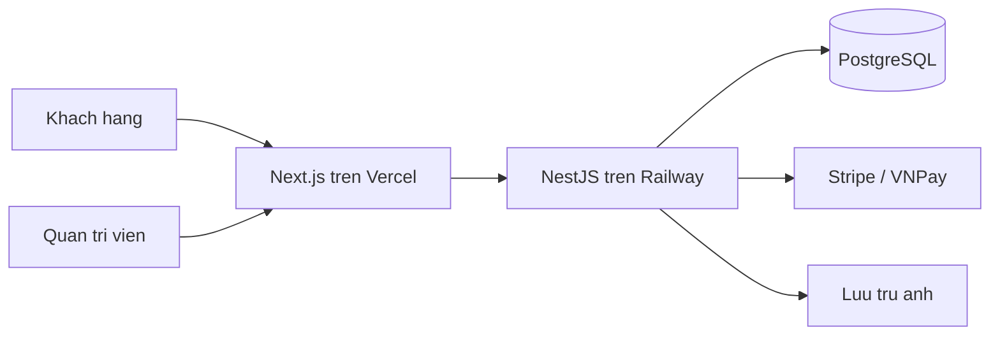

# Website bán đồ tennis: kế hoạch triển khai

## 1. Phạm vi phiên bản đầu (đã chốt)
- Danh mục sản phẩm: vợt, giày, quần áo, bóng, phụ kiện. Có tìm kiếm và bộ lọc (thương hiệu, giá, size, trình độ).
- Giỏ hàng và đặt hàng.
- Thanh toán online (Stripe cho thẻ quốc tế; VNPay/MoMo nếu bán tại Việt Nam) và thanh toán khi nhận hàng.
- Đăng ký, đăng nhập, lịch sử đơn hàng.
- Trang quản trị: sản phẩm, đơn hàng, tồn kho.
- Deploy bằng dịch vụ cloud quản lý sẵn.

## 2. Vai trò trong "team"
- Product Owner / Business Analyst: viết yêu cầu, danh sách tính năng, tiêu chí nghiệm thu.
- UI/UX Designer: phong cách, màu sắc, bố cục, thành phần giao diện.
- Frontend Developer: Next.js.
- Backend Developer: NestJS và API.
- Database Engineer: thiết kế schema PostgreSQL.
- QA / Tester: kiểm thử tự động và thủ công.
- DevOps: CI/CD, biến môi trường, deploy, giám sát.

## 3. Công nghệ
- FE: Next.js (App Router) + TypeScript + Tailwind CSS + shadcn/ui, SEO tốt, giao diện hiện đại.
- BE: NestJS + TypeScript, REST API, tài liệu Swagger, xác thực JWT, kiểm tra dữ liệu đầu vào.
- Database: PostgreSQL với Prisma ORM (an toàn kiểu dữ liệu, migration rõ ràng). Chọn vì dữ liệu đơn hàng và tồn kho cần giao dịch (transaction) chặt chẽ.
- Ảnh sản phẩm: Cloudinary hoặc S3 tương thích.
- Thanh toán: Stripe (và VNPay/MoMo tuỳ thị trường), xử lý qua webhook.
- Cấu trúc: monorepo `apps/web` (Next.js), `apps/api` (NestJS), `packages/shared` (kiểu dữ liệu chung).

## 4. Thiết kế giao diện
- Phong cách tối giản, hiện đại: nhiều khoảng trắng, ảnh sản phẩm lớn, màu chủ đạo xanh lá tennis kết hợp trắng/đen, chữ không chân sạch.
- Trang chính: Trang chủ (banner, sản phẩm nổi bật), Danh sách sản phẩm (lọc), Chi tiết sản phẩm (ảnh, size, tồn kho), Giỏ hàng, Thanh toán, Tài khoản, Quản trị.
- Tương thích điện thoại trước (mobile-first), hỗ trợ chế độ sáng/tối nếu còn thời gian.

## 5. Các giai đoạn và đầu ra
1. Khởi tạo: tạo monorepo, cấu hình lint, TypeScript, Docker Compose cho PostgreSQL cục bộ.
2. Thiết kế dữ liệu: User, Product, Variant (size/màu), Category, Brand, Cart, Order, OrderItem, Payment, Address.
3. Backend: auth, sản phẩm, giỏ hàng, đơn hàng, thanh toán, API quản trị, phân quyền (khách / admin).
4. Frontend: hệ thống giao diện, các trang khách hàng, rồi trang quản trị.
5. Tích hợp thanh toán và webhook; dữ liệu mẫu (seed) để xem thử.
6. Kiểm thử: unit test (Jest) cho BE, E2E (Playwright) cho luồng mua hàng, kiểm tra bảo mật cơ bản (xác thực, phân quyền, chống nhập liệu độc hại).
7. Deploy: FE lên Vercel, BE và PostgreSQL lên Railway, cấu hình biến môi trường, tên miền, HTTPS, CI/CD qua GitHub.
8. Bàn giao: hướng dẫn dùng trang quản trị bằng tiếng Việt, hướng dẫn thêm sản phẩm, sao lưu.

## 6. Giả định (nói nếu muốn đổi)
- Ngôn ngữ giao diện: tiếng Việt, đơn vị tiền VND.
- Chưa có tên thương hiệu, logo, tên miền. Tôi sẽ dùng tên tạm và bạn thay sau.
- Chưa tích hợp vận chuyển tự động (GHN/GHTK), email marketing, đa ngôn ngữ. Có thể thêm ở phiên bản sau.

## 7. Việc bạn cần cung cấp khi bắt đầu
- Tài khoản GitHub, Vercel, Railway (tôi hướng dẫn từng bước).
- Tài khoản cổng thanh toán (Stripe hoặc VNPay/MoMo); lúc đầu dùng chế độ thử (sandbox).
- Tên cửa hàng, logo (nếu có), danh sách vài sản phẩm thật để nhập thử.